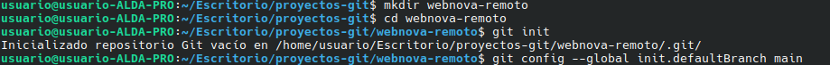
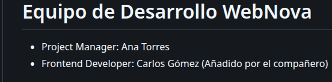
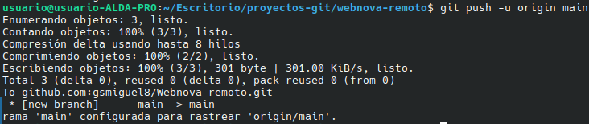
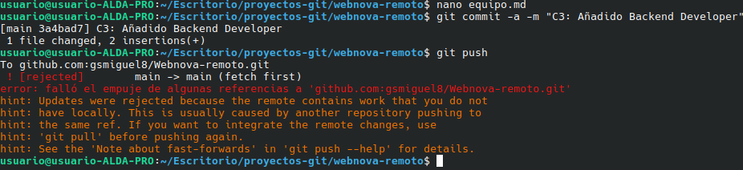
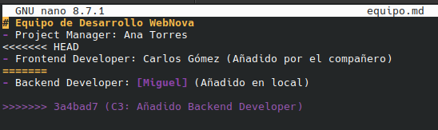
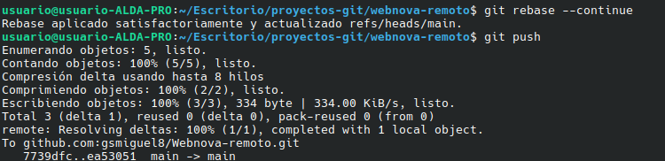
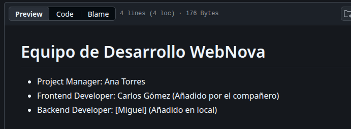

# Práctica 5: Ramas y conflictos en Git

**Proyecto:** WebNova
**Autor:** Miguel García

---

## 1. Preparar el proyecto

Creamos la carpeta, ponemos `main` como rama por defecto e iniciamos el repositorio.

```bash
mkdir webnova-remoto
cd webnova-remoto
git config --global init.defaultBranch main
git init
```



Dentro creamos un `equipo.md` muy simple:

```bash
- # Equipo de Desarrollo WebNova
- Project Manager: Ana Torres
```



Y hacemos el primer commit:

```bash
git add equipo.md
git commit -m "C1:Creación del archivo de equipo"
```


Copiamos la URL SSH del respositorio y vinculamos a nuestro terminal:

```bash
git remote add origin git@github.com:gsmiguel8webnova-remoto.git
git push -u origin main
```



---

## 2. El compañero virtual

Vamos a simular que un compañero de trabajo actualiza el repositorio en `GitHub` mientras seguimos trabajando

```bash
- # Equipo de Desarrollo WebNova
- Project Manager: Ana Torres
- Frontend Developer: Carlos Gómez (Añadido por el compañero)
- C2: Añadido Frontend Developer"
```

---

## 3. Creacion del conflicto

Mientras nuestro compañero realzia el anterior commit desde  `GituHub` nosotros realizamos lo siguiente:


```bash
- # Equipo de Desarrollo WebNova
- Project Manager: Ana Torres
- Backend Developer: [Miguel] (Añadido en local)
- git commit -a -m "C3: Añadido Backend Developer"
- git push
```

Conflicto generado: 




| palabra | sirve | 
|------|------|
| `rejected` | Palabra para denerjar la subida |
| `hint` | Recomienda integrar actualizar cambios remotos |


---


## 4. Rescate y solución

Descubierto cual era el problema vamos a rescatar el proyecto:

```bash
git pull --rebase
```

git detiene el proceso y nos informara del conflicto en nuestro archivo `equipo.md`



borramos las marcas de git:  

```bash
- # Equipo de Desarrollo WebNova
- Project Manager: Ana Torres
- Frontend Developer: Carlos Gómez (Añadido por el compañero)
- Backend Developer: [Miguel] (Añadido en local)
```


guardamos el archivo e indicamos que esta solucionado y volvemos a intentar subirlo:

```bash
git add equipo.md
git rebase --continue
```




```bash
git push
```


Comprobamos en `Github`  esta actualizado:





